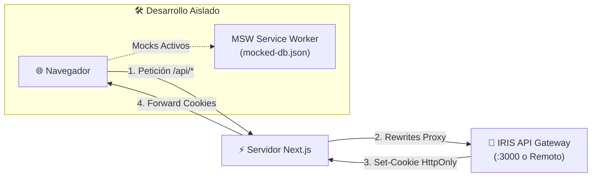

<div align="center">

<strong><h1>Iris - Sistema de Evaluación de Proyectos (Frontend)</h1></strong>

<a name="readme-top"></a>

[![Contributors][contributors-shield]][contributors-url]
[![Forks][forks-shield]][forks-url]
[![Stargazers][stars-shield]][stars-url]
[![Issues][issues-shield]][issues-url]

<br>

<a href="https://github.com/PCPI-UN/iris-front" target="_blank" rel="noopener noreferrer">
  
</a>

</div>

<br>

## 📎 Descripción

**Iris** es una plataforma web desarrollada para la gestión integral, administración y calificación de proyectos académicos y competencias universitarias por parte de jurados y comités evaluadores. Permite coordinar eventos, equipos participantes, asignación de jurados, rúbricas de evaluación y generación de rankings y reportes en tiempo real.

### Contexto del Proyecto

Este frontend forma parte del ecosistema **IRIS V3**, desarrollado por estudiantes de Ingeniería de Sistemas de la **Universidad del Norte** en la asignatura **Diseño de Software 2** bajo la dirección del profesor **Daniel Romero**. Está diseñado bajo estándares modernos de experiencia de usuario, accesibilidad, tipado estricto y arquitectura modular.

### Características Principales

- 🎯 **Gestión Integral de Eventos:** Creación, configuración de fechas clave (inicio, fin, límite de inscripciones) y estados de ciclo de vida.
- 👥 **Inscripción y Administración de Equipos:** Registro de proyectos, integrantes, áreas temáticas y categorías.
- ⭐ **Evaluación por Jurados:** Calificación guiada con rúbricas cuantitativas y cualitativas, manejo de empates y cálculo automatizado de notas.
- 💬 **Discusiones y Retroalimentación:** Canales de retroalimentación estructurada entre jurados y participantes.
- 🔐 **Seguridad y Acceso Basado en Roles (RBAC):** Control de acceso protegido para Administradores, Jurados y Participantes mediante tokens JWT en cookies HttpOnly.
- 📊 **Panel de Monitoreo y Reportes:** Métricas de avance de evaluaciones y exportación de rankings a formatos abiertos (Excel/JSON).

<p align="right">
  (<strong><a href="#readme-top">regresar al inicio</a></strong>)
</p>

<a name="readme-index"></a>

---

## 🗂️ Índice

<details open>
  <summary><strong>Tabla de Contenidos</strong></summary>

1. [🚀 Tech Stack](#1--tech-stack)
2. [🏗️ Arquitectura del Proyecto](#2-️-arquitectura-del-proyecto)
3. [📋 Requisitos Previos](#3--requisitos-previos)
4. [🔐 Configuración de Variables de Entorno](#4--configuración-de-variables-de-entorno)
5. [⚡ Instalación y Modos de Ejecución Local](#5-️-instalación-y-modos-de-ejecución-local)
   - [Paso 1: Clonar e instalar dependencias](#paso-1-clonar-e-instalar-dependencias)
   - [Paso 2: Configurar variables](#paso-2-configurar-variables)
   - [Modo 1: Desarrollo con Mocks (Uso Habitual)](#modo-1-desarrollo-con-mocks-uso-habitual)
   - [Modo 2: Conexión a Backend Remoto](#modo-2-conexión-a-backend-remoto-test--staging)
   - [Modo 3: Full-Stack Contenerizado (Docker Compose)](#modo-3-full-stack-contenerizado-docker-compose)
6. [📜 Scripts Disponibles](#6--scripts-disponibles)
7. [🚢 Procedimiento de Despliegue en Producción](#7--procedimiento-de-despliegue-en-producción)
8. [🌐 Servicios Externos e Integraciones](#8--servicios-externos-e-integraciones)
9. [🛠️ Comandos Útiles y Resolución de Problemas (Troubleshooting)](#9-️-comandos-útiles-y-resolución-de-problemas-troubleshooting)
10. [👥 Equipo de Desarrollo y Contribución](#10--equipo-de-desarrollo-y-contribución)

</details>

<p align="right">
  (<strong><a href="#readme-top">regresar al inicio</a></strong>)
</p>

<a name="1--tech-stack"></a>

---

## 1. 🚀 Tech Stack

### Framework y Núcleo
- [![Next.js][nextjs-badge]][nextjs-url] **Next.js 15 (App Router):** Renderizado híbrido (SSR/CSR), motor de empaquetado Turbopack y optimización de rutas.
- [![React][react-badge]][react-url] **React 19:** Biblioteca base de componentes de interfaz.
- [![TypeScript][typescript-badge]][typescript-url] **TypeScript:** Tipado estático estricto en toda la aplicación.
- [![Tailwind CSS][tailwind-badge]][tailwind-url] **Tailwind CSS:** Framework utilitario para diseño responsivo.

### UI y Experiencia de Usuario
- [![HeroUI][heroui-badge]][heroui-url] **HeroUI:** Biblioteca de componentes accesibles y personalizables.
- [![Radix UI][radix-badge]][radix-url] **Radix UI:** Primitivas sin estilos para interacciones complejas.
- [![Framer Motion][framer-badge]][framer-url] **Framer Motion:** Animaciones fluidas para transiciones y modales.
- [![Lucide React][lucide-badge]][lucide-url] **Lucide Icons:** Conjunto de iconos vectoriales optimizados.

### Gestión de Estado y Validación
- [![TanStack Query][tanstack-badge]][tanstack-url] **TanStack Query (React Query v5):** Caché de datos asíncronos y sincronización con servidor.
- [![Zustand][zustand-badge]][zustand-url] **Zustand:** Manejo de estado global en memoria del cliente.
- [![React Hook Form][rhf-badge]][rhf-url] **React Hook Form:** Control reactivo y performante de formularios.
- [![Zod][zod-badge]][zod-url] **Zod:** Validación declarativa de esquemas y variables de entorno.

### Testing y Calidad de Código
- [![Vitest][vitest-badge]][vitest-url] **Vitest:** Pruebas unitarias ultrarrápidas con soporte nativo para TypeScript.
- [![Playwright][playwright-badge]][playwright-url] **Playwright:** Pruebas end-to-end (E2E) simulando navegadores reales.
- [![Testing Library][testing-library-badge]][testing-library-url] **Testing Library:** Utilidades de pruebas centradas en el usuario.
- [![MSW][msw-badge]][msw-url] **Mock Service Worker (MSW):** Intercepción de red a nivel de red para desacoplar el desarrollo del backend.
- [![ESLint][eslint-badge]][eslint-url] **ESLint & Prettier:** Reglas de calidad y formateo automatizado.
- [![Storybook][storybook-badge]][storybook-url] **Storybook:** Documentación interactiva de componentes de catálogo.

<p align="right">
  (<strong><a href="#readme-top">regresar al inicio</a></strong>)
</p>

<a name="2-️-arquitectura-del-proyecto"></a>

---

## 2. 🏗️ Arquitectura del Proyecto

El frontend implementa una arquitectura **Feature-Based** (inspirada en *Bulletproof React*), agrupando el código por dominios de negocio funcionales en lugar de por tipos técnicos de archivo.

### Estructura de Directorios

```
frontend/
├── .github/              # Plantillas de PR y configuraciones de CI
├── public/               # Recursos estáticos (logos, imágenes, favicon)
├── src/
│   ├── app/              # Páginas y layouts de Next.js (App Router)
│   │   ├── (auth)/       # Rutas de autenticación pública (login, signup)
│   │   ├── app/          # Rutas protegidas de la plataforma (dashboard, admin)
│   │   ├── provider.tsx  # Proveedores globales (React Query, HeroUI, MSW)
│   │   └── layout.tsx    # Layout raíz
│   ├── components/       # Componentes transversales y UI reutilizable
│   │   ├── ui/           # Botones, inputs, modales, tablas base
│   │   └── errors/       # Error Boundaries y vistas de excepción
│   ├── config/           # Configuración central (env.ts con Zod, rutas, fuentes)
│   ├── features/         # Módulos de dominio de la aplicación
│   │   ├── auth/         # Lógica, componentes y hooks de autenticación
│   │   ├── events/       # Gestión y visualización de eventos
│   │   ├── projects/     # Administración de proyectos y postulaciones
│   │   ├── evaluations/  # Flujo de calificación de jurados
│   │   └── dashboard/    # Panel principal por roles
│   ├── hooks/            # Custom hooks globales
│   ├── lib/              # Clientes de librerías (api-client.ts, auth.tsx, react-query.ts)
│   ├── styles/           # Archivos CSS y variables globales de Tailwind
│   ├── testing/          # Configuración de pruebas y mocks
│   │   └── mocks/        # Base de datos en memoria (db.ts) y handlers de MSW
│   ├── types/            # Definiciones globales de TypeScript
│   └── utils/            # Funciones auxiliares puras
├── middleware.ts         # Middleware de Next.js para protección de rutas y sesión
├── mock-server.ts        # Servidor mock independiente en Express para pruebas E2E
├── Dockerfile            # Construcción multi-etapa optimizada para producción
├── Dockerfile.dev        # Imagen liviana para desarrollo con Docker Compose
└── package.json          # Scripts, dependencias y metadata del proyecto
```

### Flujo de Comunicación y Seguridad



1. **Proxy Transparente (`rewrites`):** En `next.config.js`, todas las peticiones con prefijo `/api/:path*` son redirigidas internamente hacia `${API_URL}/:path*`. Esto evita problemas de CORS y permite que las credenciales fluyan limpiamente.
2. **Autenticación sin Exposición:** Las credenciales y tokens JWT (`access_token`, `refresh_token`) viajan en cookies `HttpOnly` y `SameSite`. El cliente JavaScript no manipula secretos en el `localStorage`.
3. **Middleware de Rutas Protegidas:** `middleware.ts` intercepta cualquier intento de navegación bajo `/app/:path*`. Si no existe cookie de sesión válida, redirige automáticamente a `/auth/login?redirectTo=...`.

<p align="right">
  (<strong><a href="#readme-top">regresar al inicio</a></strong>)
</p>

<a name="3--requisitos-previos"></a>

---

## 3. 📋 Requisitos Previos

Para ejecutar el frontend en entorno local se requiere:

- **Node.js:** Versión `20.x` o `22.x` LTS.
- **pnpm:** Versión `9.x` o superior (`corepack enable` o `npm install -g pnpm`).
- **Docker & Docker Compose v2 (Opcional):** Requerido únicamente si se desea ejecutar el frontend contenerizado o el stack completo de microservicios.

<p align="right">
  (<strong><a href="#readme-top">regresar al inicio</a></strong>)
</p>

<a name="4--configuración-de-variables-de-entorno"></a>

---

## 4. 🔐 Configuración de Variables de Entorno

Toda la configuración se gestiona a través del archivo `.env.local` (en desarrollo local) o `.env` (en contenedores Docker).

Para crear el archivo de configuración base:

```bash
cp .env.example .env.local
```

### Tabla de Variables (Sin Secretos)

| Variable | Tipo | Valor por Defecto | Ámbito | Descripción |
| :--- | :--- | :--- | :--- | :--- |
| `API_URL` | URL | `https://iris-api-test.uninorte.edu.co/` | Servidor (Node / Next.js) | URL base del backend hacia donde el proxy interno redirige `/api/*`. No se expone al cliente. |
| `NEXT_PUBLIC_ENABLE_API_MOCKING` | Boolean | `false` | Cliente (Browser) | Activa MSW en el navegador para interceptar peticiones y responder con datos ficticios. |
| `NEXT_PUBLIC_URL` | URL | `http://localhost:3000` | Cliente (Browser) | URL pública en la que el usuario visualiza la aplicación. |
| `NEXT_PUBLIC_MOCK_API_PORT` | Número | `8000` | Ambos | Puerto de escucha para el servidor HTTP de mocks (`mock-server.ts`). |
| `PORT` | Número | `3000` | Servidor | Puerto donde escucha el servidor de Next.js (utilizado principalmente en Docker). |

> [!IMPORTANT]
> **Variables de Build Time (`NEXT_PUBLIC_`):**  
> Las variables que inician con `NEXT_PUBLIC_` son inyectadas en el código empaquetado del navegador durante la compilación (`pnpm build`). Al construir imágenes de Docker, deben proporcionarse como argumentos de construcción (`--build-arg`).

<p align="right">
  (<strong><a href="#readme-top">regresar al inicio</a></strong>)
</p>

<a name="5-️-instalación-y-modos-de-ejecución-local"></a>

---

## 5. ⚡ Instalación y Modos de Ejecución Local

<a name="paso-1-clonar-e-instalar-dependencias"></a>
### Paso 1: Clonar e instalar dependencias

```bash
# 1. Clonar el repositorio
git clone git@github.com:PCPI-UN/iris-front.git
cd iris-front

# 2. Instalar dependencias con pnpm
pnpm install
```

<a name="paso-2-configurar-variables"></a>
### Paso 2: Configurar variables

Cree su archivo de entorno local:

```bash
cp .env.example .env.local
```

---

<a name="modo-1-desarrollo-con-mocks-uso-habitual"></a>
### Modo 1: Desarrollo con Mocks (Uso Habitual)

> [!TIP]
> **Recomendado para el trabajo diario:**  
> No necesitas levantar Docker ni compilar el backend de microservicios para trabajar en la interfaz.

#### Opción A: Mocks en Navegador con MSW (Sin procesos adicionales)
Ideal para desarrollo de componentes, diseño y pantallas:

1. Configure en su `.env.local`:
   ```env
   NEXT_PUBLIC_ENABLE_API_MOCKING=true
   NEXT_PUBLIC_URL=http://localhost:3000
   ```
2. Inicie el servidor de desarrollo:
   ```bash
   pnpm dev
   ```
3. Abra [http://localhost:3000](http://localhost:3000). Verá en la consola del navegador: `[MSW] Mocking enabled`. Todas las peticiones consumirán la base de datos simulada en `src/testing/mocks/`.

#### Opción B: Servidor Mock Dedicado (Express HTTP)
Ideal si se ejecutan pruebas E2E con Playwright o se necesita un servidor HTTP real para los mocks:

1. Inicie el servidor de mocks en una terminal:
   ```bash
   pnpm run-mock-server
   ```
   *(Inicia en `http://localhost:8000` con recarga automática)*

2. En `.env.local`, apunte el proxy hacia el puerto del mock server:
   ```env
   API_URL=http://localhost:8000
   NEXT_PUBLIC_ENABLE_API_MOCKING=false
   NEXT_PUBLIC_URL=http://localhost:3000
   ```
3. En otra terminal, levante el frontend:
   ```bash
   pnpm dev
   ```

---

<a name="modo-2-conexión-a-backend-remoto-test--staging"></a>
### Modo 2: Conexión a Backend Remoto (Test / Staging)

Cuando necesite probar funcionalidades con datos reales y endpoints integrados sin ejecutar Docker localmente:

1. Configure su `.env.local` apuntando al backend de pruebas de la universidad:
   ```env
   API_URL=https://iris-api-test.uninorte.edu.co/
   NEXT_PUBLIC_ENABLE_API_MOCKING=false
   NEXT_PUBLIC_URL=http://localhost:3000
   ```
2. Inicie el frontend:
   ```bash
   pnpm dev
   ```
3. Ingrese a [http://localhost:3000](http://localhost:3000). El proxy de Next.js enviará las peticiones a la API remota de manera transparente.

---

<a name="modo-3-full-stack-contenerizado-docker-compose"></a>
### Modo 3: Full-Stack Contenerizado (Docker Compose)

Si está trabajando en la raíz del ecosistema de IRIS (`iris/`) con todos los microservicios locales:

1. Desde la raíz del repositorio principal, ejecute:
   ```bash
   make up
   # O directamente:
   docker compose up -d
   ```
2. **Distribución de puertos:**
   - **Backend API Gateway:** Escucha en el puerto `3000` (`http://localhost:3000`).
   - **Frontend:** Se expone automáticamente en el puerto `3001` (`http://localhost:3001`).
3. Para ver los logs del frontend en vivo:
   ```bash
   docker compose logs -f frontend
   ```

<p align="right">
  (<strong><a href="#readme-top">regresar al inicio</a></strong>)
</p>

<a name="6--scripts-disponibles"></a>

---

## 6. 📜 Scripts Disponibles

El archivo `package.json` incluye los siguientes comandos de soporte:

| Script | Comando | Descripción |
| :--- | :--- | :--- |
| **Desarrollo** | `pnpm dev` | Inicia Next.js en modo desarrollo con soporte de Turbopack. |
| **Compilación** | `pnpm build` | Genera el bundle optimizado para producción en `.next/`. |
| **Arranque Prod** | `pnpm start` | Inicia el servidor de producción previamente compilado. |
| **Tipado** | `pnpm check-types` | Valida TypeScript sin emitir archivos (`tsc --noEmit`). |
| **Linter** | `pnpm lint` | Analiza el código con ESLint y corrige problemas automáticos. |
| **Tests Unitarios** | `pnpm test` | Ejecuta la suite de pruebas unitarias y de componentes con Vitest. |
| **Tests E2E** | `pnpm test-e2e` | Levanta el servidor mock y corre las pruebas E2E con Playwright. |
| **Mock Server** | `pnpm run-mock-server` | Levanta el servidor Express con MSW en el puerto `8000`. |
| **Storybook** | `pnpm storybook` | Inicia el entorno interactivo de componentes en el puerto `6006`. |
| **Build Storybook** | `pnpm build-storybook`| Genera los archivos estáticos de Storybook para despliegue. |
| **Generador** | `pnpm generate` | Crea componentes, features y hooks siguiendo la plantilla de Plop. |

<p align="right">
  (<strong><a href="#readme-top">regresar al inicio</a></strong>)
</p>

<a name="7--procedimiento-de-despliegue-en-producción"></a>

---

## 7. 🚢 Procedimiento de Despliegue en Producción

El frontend está optimizado para ejecutarse en contenedores Docker mediante una construcción multi-etapa (*multi-stage build*) con altos estándares de seguridad y rendimiento.

### Características de la Imagen de Producción

- **Multi-stage (`node:22-alpine`):** Aísla las dependencias de desarrollo y descarta herramientas no requeridas en tiempo de ejecución.
- **Seguridad (No-root):** La aplicación corre bajo un usuario sin privilegios del sistema (`nextjs`, UID `1001`).
- **Manejo de Señales (`dumb-init`):** Gestiona adecuadamente las señales `SIGTERM`/`SIGINT` de Docker para apagado controlado.
- **Healthcheck Integrado:** Evalúa periódicamente el estado de la aplicación mediante peticiones HTTP locales a través de Node.js.

### Despliegue con Docker Compose (Independiente)

Para desplegar únicamente el frontend en un servidor o VPS:

1. Configure las variables de producción en `.env`:
   ```env
   NODE_ENV=production
   PORT=3000
   API_URL=https://api.iris.uninorte.edu.co
   NEXT_PUBLIC_URL=https://iris.uninorte.edu.co
   NEXT_PUBLIC_ENABLE_API_MOCKING=false
   ```

2. Construya y levante el contenedor:
   ```bash
   docker compose -f docker-compose.yml up -d --build
   ```

3. Verifique el estado del contenedor y su healthcheck:
   ```bash
   docker compose ps
   docker compose logs -f frontend
   ```

### Construcción Manual de la Imagen Docker

Si se publica la imagen a un registro (Docker Hub, GitHub Container Registry, etc.):

```bash
docker build \
  --build-arg API_URL="https://api.iris.uninorte.edu.co" \
  --build-arg NEXT_PUBLIC_URL="https://iris.uninorte.edu.co" \
  --build-arg NEXT_PUBLIC_ENABLE_API_MOCKING="false" \
  -t pcpi-un/iris-frontend:latest .
```

### Despliegue en Dokploy / PaaS

Al configurar una aplicación en **Dokploy** o **Coolify**:
- **Tipo de Despliegue:** Dockerfile.
- **Puerto del Contenedor:** `3000`.
- **Variables de Entorno (Environment & Build Args):** Definir `API_URL` apuntando al Gateway interno (ej. `http://gateway:3000` en la red compartida `dokploy-network`) o a la URL pública con SSL.
- **Límites Recomendados:** `1 CPU`, `1 GB RAM` (reserva mínima `512 MB`).

<p align="right">
  (<strong><a href="#readme-top">regresar al inicio</a></strong>)
</p>

<a name="8--servicios-externos-e-integraciones"></a>

---

## 8. 🌐 Servicios Externos e Integraciones

### 🚪 IRIS API Gateway
- Punto de entrada unificado para todas las solicitudes del frontend.
- Expone los endpoints REST que orquestan las operaciones con los microservicios internos (`auth`, `event`, `project`, `evaluation`, `invitation`, `notification`) mediante gRPC.

### 📦 Azure Blob Storage
- Repositorio en la nube utilizado para el almacenamiento de archivos multimedia, logos de eventos, documentos PDF y entregables de proyectos postulados.
- Las imágenes y adjuntos son consumidos a través de URLs públicas o enlaces prefirmados generados por el backend.

### 🛠️ Mock Service Worker (MSW)
- Infraestructura de simulación de API integrada en el repositorio (`mocked-db.json`).
- Permite que nuevos desarrolladores comiencen a programar en el frontend en menos de 2 minutos sin necesidad de aprovisionar bases de datos ni servicios en la nube.

<p align="right">
  (<strong><a href="#readme-top">regresar al inicio</a></strong>)
</p>

<a name="9-️-comandos-útiles-y-resolución-de-problemas-troubleshooting"></a>

---

## 9. 🛠️ Comandos Útiles y Resolución de Problemas (Troubleshooting)

### 🔴 Conflicto de Puertos (Puerto 3000 en uso)
- **Problema:** Tanto el API Gateway como el Frontend intentan usar el puerto `3000`.
- **Solución:**  
  - Al usar el stack de la raíz (`compose.yml`), el frontend ya está configurado para exponerse en el puerto `3001` (`ports: ["3001:3000"]`).
  - Si ejecuta de forma nativa con `pnpm dev`, puede definir un puerto alternativo:
    ```bash
    pnpm dev -p 3001
    ```
    Y actualice `NEXT_PUBLIC_URL=http://localhost:3001` en su `.env.local`.

### 🍪 Problemas con Cookies de Sesión y Autenticación
- **Problema:** Inicia sesión con éxito pero al navegar a `/app` es redirigido a `/auth/login`.
- **Causa:** Las cookies del backend se rechazan si hay inconsistencia entre `SameSite`, `Secure` o dominios distintos.
- **Solución:**
  - Asegúrese de acceder a la aplicación mediante el mismo host configurado en `NEXT_PUBLIC_URL` (use `localhost`, no mezcle `localhost` con `127.0.0.1`).
  - Si el backend corre en local, verifique que en el `.env` del backend `ALLOW_INSECURE_COOKIES=true`.

### 🧹 Limpieza de Caché y Artefactos de Construcción
Si experimenta errores inesperados con Turbopack o actualizaciones de módulos:

```bash
# Limpiar caché de Next.js
rm -rf .next

# Reinstalar dependencias de forma limpia
rm -rf node_modules pnpm-lock.yaml
pnpm install
```

### ⚡ Error de Memoria en `pnpm build`
En máquinas con recursos limitados o al compilar en Docker, aumente la memoria máxima asignada a Node.js:

```bash
export NODE_OPTIONS="--max-old-space-size=4096"
pnpm build
```

<p align="right">
  (<strong><a href="#readme-top">regresar al inicio</a></strong>)
</p>

<a name="10--equipo-de-desarrollo-y-contribución"></a>

---

## 10. 👥 Equipo de Desarrollo y Contribución

### Lineamientos de Contribución

Antes de realizar cambios o enviar contribuciones:
1. Consulte la [Guía de Contribución](CONTRIBUTING.md) para conocer las convenciones de ramas (`feat/`, `fix/`, `docs/`) y formato de Pull Requests.
2. Los mensajes de commit están auditados por **Husky** y **commitlint** (`commitlint.config.ts`), y deben incluir obligatoriamente el identificador de la tarea de ClickUp:
   ```
   [CU-<taskId>]: <descripción o tipo: mensaje>
   ```
   *Ejemplo:* `[CU-86e3vmxab]: update installation, local development and deployment README`
3. Ejecute `pnpm check-types` y `pnpm lint` antes de realizar commit. Husky ejecutará validaciones automáticas.

### Universidad del Norte
**Diseño de Software 2**  
**Profesor:** Daniel Romero  

Este proyecto es desarrollado y mantenido por estudiantes de Ingeniería de Sistemas de la Universidad del Norte como parte del desarrollo del sistema **IRIS V3**.

<div align="center">

**¡Gracias a todos los colaboradores por su dedicación!**

[](https://github.com/PCPI-UN/iris-front/graphs/contributors)

</div>

<!-- Badges y Enlaces -->

[contributors-shield]: https://img.shields.io/github/contributors/PCPI-UN/iris-front.svg?style=for-the-badge
[contributors-url]: https://github.com/PCPI-UN/iris-front/graphs/contributors
[forks-shield]: https://img.shields.io/github/forks/PCPI-UN/iris-front.svg?style=for-the-badge
[forks-url]: https://github.com/PCPI-UN/iris-front/network/members
[stars-shield]: https://img.shields.io/github/stars/PCPI-UN/iris-front.svg?style=for-the-badge
[stars-url]: https://github.com/PCPI-UN/iris-front/stargazers
[issues-shield]: https://img.shields.io/github/issues/PCPI-UN/iris-front.svg?style=for-the-badge
[issues-url]: https://github.com/PCPI-UN/iris-front/issues

[nextjs-url]: https://nextjs.org/
[react-url]: https://react.dev/
[typescript-url]: https://www.typescriptlang.org/
[tailwind-url]: https://tailwindcss.com/
[heroui-url]: https://www.heroui.com/
[radix-url]: https://www.radix-ui.com/
[framer-url]: https://www.framer.com/motion/
[lucide-url]: https://lucide.dev/
[tanstack-url]: https://tanstack.com/query/latest
[zustand-url]: https://zustand-demo.pmnd.rs/
[rhf-url]: https://react-hook-form.com/
[zod-url]: https://zod.dev/
[vitest-url]: https://vitest.dev/
[playwright-url]: https://playwright.dev/
[testing-library-url]: https://testing-library.com/
[eslint-url]: https://eslint.org/
[prettier-url]: https://prettier.io/
[storybook-url]: https://storybook.js.org/
[msw-url]: https://mswjs.io/

[nextjs-badge]: https://img.shields.io/badge/Next.js-000000?style=for-the-badge&logo=next.js&logoColor=white
[react-badge]: https://img.shields.io/badge/React-61DAFB?style=for-the-badge&logo=react&logoColor=black
[typescript-badge]: https://img.shields.io/badge/TypeScript-3178C6?style=for-the-badge&logo=typescript&logoColor=white
[tailwind-badge]: https://img.shields.io/badge/Tailwind_CSS-06B6D4?style=for-the-badge&logo=tailwindcss&logoColor=white
[heroui-badge]: https://img.shields.io/badge/HeroUI-7C3AED?style=for-the-badge&logo=react&logoColor=white
[radix-badge]: https://img.shields.io/badge/Radix_UI-161618?style=for-the-badge&logo=radix-ui&logoColor=white
[framer-badge]: https://img.shields.io/badge/Framer_Motion-0055FF?style=for-the-badge&logo=framer&logoColor=white
[lucide-badge]: https://img.shields.io/badge/Lucide-F56565?style=for-the-badge&logo=lucide&logoColor=white
[tanstack-badge]: https://img.shields.io/badge/TanStack_Query-FF4154?style=for-the-badge&logo=react-query&logoColor=white
[zustand-badge]: https://img.shields.io/badge/Zustand-443E38?style=for-the-badge&logo=react&logoColor=white
[rhf-badge]: https://img.shields.io/badge/React_Hook_Form-EC5990?style=for-the-badge&logo=reacthookform&logoColor=white
[zod-badge]: https://img.shields.io/badge/Zod-3E67B1?style=for-the-badge&logo=zod&logoColor=white
[vitest-badge]: https://img.shields.io/badge/Vitest-6E9F18?style=for-the-badge&logo=vitest&logoColor=white
[playwright-badge]: https://img.shields.io/badge/Playwright-2EAD33?style=for-the-badge&logo=playwright&logoColor=white
[testing-library-badge]: https://img.shields.io/badge/Testing_Library-E33332?style=for-the-badge&logo=testing-library&logoColor=white
[eslint-badge]: https://img.shields.io/badge/ESLint-4B32C3?style=for-the-badge&logo=eslint&logoColor=white
[prettier-badge]: https://img.shields.io/badge/Prettier-F7B93E?style=for-the-badge&logo=prettier&logoColor=black
[storybook-badge]: https://img.shields.io/badge/Storybook-FF4785?style=for-the-badge&logo=storybook&logoColor=white
[msw-badge]: https://img.shields.io/badge/MSW-FF6A33?style=for-the-badge&logo=mock-service-worker&logoColor=white
